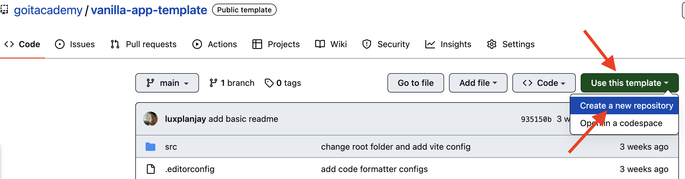
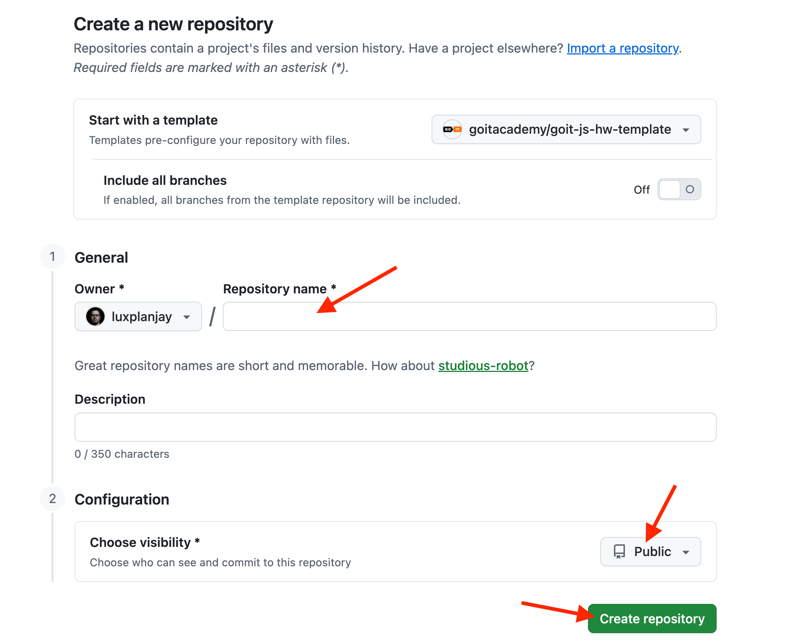
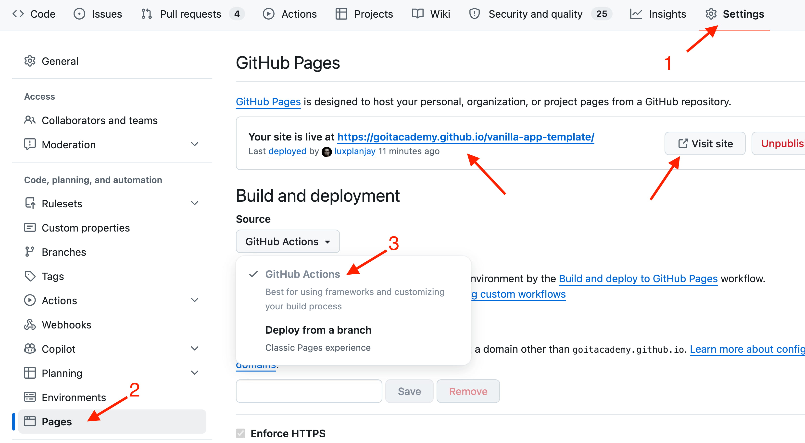
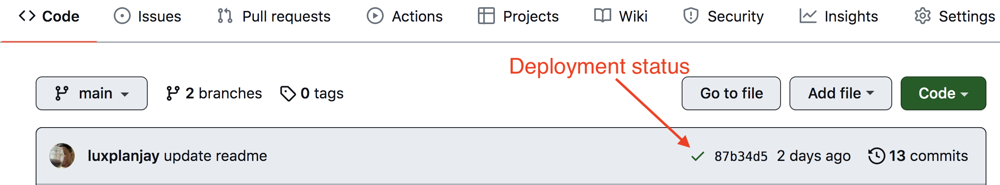
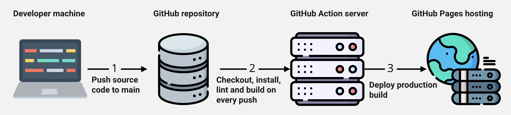

<<<<<<< HEAD
# Web Team Project Template

Цей шаблон для командних проєктів створено за допомогою Vite. Для знайомства та налаштування
додаткових можливостей [звернись до документації](https://vitejs.dev/).

## Створення репозиторію за шаблоном

Використовуй цей репозиторій як шаблон для створення репозиторію свого проекту.
Для цього натисни на кнопку `«Use this template»` і обери опцію
`«Create a new repository»`, як показано на зображенні.

На наступному етапі відкриється сторінка створення нового репозиторію. Заповни
поле його імені, переконайся, що репозиторій публічний, після чого натисни
кнопку `«Create repository from template»`.

Після того, як репозиторій буде створено, увімкни для нього GitHub Pages:
перейди в `Settings` > `Pages` і в секції `Build and deployment` вибери `Source`
→ `GitHub Actions`. Це єдине одноразове налаштування.

Тепер у тебе є особистий репозиторій проекту, зі структурою файлів та папок
репозиторію-шаблону. Далі працюй з ним, як з будь-яким іншим особистим
репозиторієм, клонуй його собі на комп'ютер, пиши код, роби коміти та відправляй
їх на GitHub.

## Підготовка до роботи

1. Переконайся, що на комп'ютері встановлено LTS-версію Node.js.
   [Скачай та встанови](https://nodejs.org/en/) її якщо необхідно.
2. Встанови базові залежності проекту в терміналі командою `npm install`.
3. Запусти режим розробки, виконавши в терміналі команду `npm run dev`.
4. Перейдіть у браузері за адресою
   [http://localhost:5173](http://localhost:5173). Ця сторінка буде автоматично
   перезавантажуватись після збереження змін у файли проекту.

## Файли і папки

- Свій JavaScript пиши у `src/main.js` та інших файлах, які створиш за потреби.
- Файли розмітки компонентів сторінки повинні лежати в папці `src/partials` та
  імпортуватись до файлу `index.html`. Наприклад, файл з розміткою хедера
  `header.html` створюємо у папці `partials` та імпортуємо в `index.html`.
- Файли стилів повинні лежати в папці `src/css` та підключатися до HTML-файлів
  сторінок. Наприклад, `index.html` підключає `./css/styles.css`.
- Зображення додавай до папки `src/img`. Збирач оптимізує їх, але тільки при
  деплої продакшн версії проекту. Все це відбувається у хмарі, щоб не
  навантажувати твій комп'ютер, тому що на слабких компʼютерах це може зайняти
  багато часу.

## Деплой

Жива версія сторінки оновлюється автоматично: щоразу, коли ти змінюєш файли
проекту й відправляєш зміни на GitHub у гілку `main` (прямим пушем або через
прийнятий пул-реквест), проект сам перезбирається й публікується на GitHub Pages.

### Статус деплою

Статус деплою крайнього коміту відображається іконкою біля його ідентифікатора.

- **Жовтий колір** - виконується збірка та деплой проекту.
- **Зелений колір** - деплой завершився успішно.
- **Червоний колір** - під час збірки чи деплою сталася помилка.

Більш детальну інформацію про статус можна переглянути натиснувши на іконку, і в
вікні, що випадає, перейти за посиланням `Details`.

### Жива сторінка

Через якийсь час, зазвичай кілька хвилин, живу сторінку можна буде подивитися за
адресою, вказаною на вкладці `Settings` > `Pages` в налаштуваннях твого
репозиторію. Для прикладу, ось посилання на живу версію цього репозиторію-шаблону —
у тебе буде своє:

[https://goitacademy.github.io/web-team-project-template/](https://goitacademy.github.io/web-team-project-template/).

Якщо відкриється порожня сторінка, перевір, що GitHub Pages увімкнено
(`Settings` > `Pages`), а останній деплой у вкладці `Actions` завершився
успішно (зелений).

## Як це працює

Під капотом: після пуша в `main` запускається GitHub Action із
`.github/workflows/deploy.yml`, який збирає проект і публікує його на GitHub
Pages. Якщо щось пішло не так — деталі у вкладці `Actions`.
=======
UA
🥽 Reality Shift VR

Reality Shift VR — це сучасний адаптивний вебсайт для VR-клубу, створений для ознайомлення відвідувачів зі світом віртуальної реальності, презентації доступних VR-ігор та можливостей відпочинку.

Сайт поєднує футуристичний дизайн, насичені фіолетові кольори, неонові акценти та атмосферні зображення VR-ігор, створюючи захопливий користувацький досвід.

🌐 Прев'ю проєкту

[ https://devantonii-k.github.io/Reality-Shift-VR/ ]

✨ Основні можливості
Головний екран (Hero Section) — яскравий вступний блок із короткою презентацією VR-клубу та кнопками заклику до дії.
Каталог VR-ігор — знайомство з доступними іграми та віртуальними розвагами, зокрема Beat Saber, Half-Life: Alyx та іншими популярними іграми.
Чому обирають Reality Shift? — презентація переваг клубу та особливостей VR-досвіду.
Тарифні плани — декілька пакетів із різними варіантами та вартістю сеансів.
Онлайн-бронювання — форма для попереднього запису на VR-сеанс.
Фотогалерея — фотографії, які демонструють атмосферу клубу та ігровий процес.
Відгуки клієнтів — відгуки та враження відвідувачів.
Адаптивний дизайн — коректне відображення сайту на комп'ютерах, планшетах і смартфонах.

🎨 Дизайн та UI/UX
Дизайн сайту виконаний у сучасному стилі з акцентом на геймінг та технології віртуальної реальності.
Візуальна концепція:

Темно-фіолетовий фон.
Яскраві фіолетові та неонові акценти.
Контрастна типографіка.
Картки із заокругленими кутами та інтерактивні кнопки.
Атмосферні зображення VR-ігор.
Єдина система відступів та стилізації компонентів.

Адаптивні версії:

Desktop — комп'ютери та ноутбуки.
Tablet — планшети.
Mobile — смартфони.
🛠️ Використані технології

Дизайн проєкту розроблений у Figma.

Технології, які використовуються під час реалізації сайту:

--HTML5
--CSS3

📂 Структура сайту

Сайт складається з таких основних секцій:
Reality-Shift-VR/
│
├── Header / Навігація
├── Hero Section / Головний екран
├── VR Games Showcase / Каталог VR-ігор
├── Why Choose Us / Переваги клубу
├── Pricing Plans / Тарифні плани
├── Booking Form / Форма бронювання
├── Photo Gallery / Фотогалерея
├── Customer Reviews / Відгуки клієнтів
└── Footer / Нижній колонтитул

🚀 Запуск проєкту

Щоб запустити проєкт локально, виконайте такі кроки:

1. Клонуйте репозиторій
bash
git clone YOUR_REPOSITORY_URL

2. Перейдіть до папки проєкту
bash
cd Reality-Shift-VR

3. Встановіть залежності

Якщо проєкт використовує npm:

bash
npm install

4. Запустіть проєкт
bash
npm run dev

Після запуску відкрийте локальну адресу, яку буде вказано в терміналі.

Примітка: команди запуску потрібно адаптувати відповідно до фактичної структури та налаштувань проєкту.

🎯 Мета проєкту
Створити сучасну онлайн-презентацію VR-клубу.
Продемонструвати доступні ігри та VR-розваги.
Зробити інформацію про тарифи зрозумілою та доступною.
Спрощувати процес бронювання VR-сеансів.
Забезпечити комфортне користування сайтом на різних пристроях.
Створити привабливий та атмосферний інтерфейс.

👨‍💻 Автори проєкту
[Команда 1, 83-ого потоку курсу "Fullstack Bootcamp" школи GoIt]

Проєкт створений з навчальною метою та для демонстрації навичок веброзробки.

⭐ Якщо вам сподобався цей проєкт, можете поставити йому зірочку на GitHub!

EN

🥽 Reality Shift VR

Reality Shift VR is a modern, responsive website for a Virtual Reality gaming club. It introduces visitors to the world of VR gaming, showcases available games and experiences, presents pricing plans, and allows customers to book their VR sessions.

The website combines a futuristic design, vibrant purple colors, neon accents, and immersive gaming visuals to create an engaging user experience.

🌐 Design Preview

[ https://devantonii-k.github.io/Reality-Shift-VR/ ]

✨ Features
Hero Section – An eye-catching introduction to the VR club with a prominent call to action.
VR Games Showcase – Discover available VR games and experiences, including Beat Saber, Half-Life: Alyx, and other popular titles.
Why Choose Reality Shift? – Highlights the main advantages of the club and its VR experience.
Pricing Plans – Multiple packages with different session options and prices.
Online Booking – A booking form that allows visitors to reserve their VR sessions.
Photo Gallery – A collection of photos showcasing the atmosphere and gaming experience.
Customer Reviews – Testimonials and feedback from visitors.
Responsive Design – Layouts designed for desktop, tablet, and mobile devices.

🎨 Design & UI/UX

The design follows a modern gaming-inspired aesthetic.

Visual Identity:

Dark purple background.
Bright purple and neon accents.
High-contrast typography.
Rounded cards and interactive buttons.
Immersive VR gaming photography.
Consistent spacing and component styling.

Responsive Layouts:

Desktop
Tablet
Mobile

🛠️ Technologies

The design was created in Figma.

Technologies used in the website implementation:
--HTML5
--CSS3

📂 Website Structure
The website is organized into the following sections:

Reality-Shift-VR/
│
├── Header / Navigation
├── Hero Section
├── VR Games Showcase
├── Why Choose Us
├── Pricing Plans
├── Booking Form
├── Photo Gallery
├── Customer Reviews
└── Footer

🚀 Getting Started

To run the project locally:

1. Clone the repository
bash
git clone YOUR_REPOSITORY_URL

2. Navigate to the project directory
bash
cd Reality-Shift-VR

3. Install dependencies

If the project uses npm:

bash
npm install

4. Run the development server
bash
npm run dev

Open the local development URL in your browser.

Note: Update these commands according to your project's actual setup.

🎯 Project Goals
Create a modern online presence for a VR gaming club.
Showcase available games and VR experiences.
Make pricing information easy to understand.
Simplify the session booking process.
Provide a consistent experience across different screen sizes.
Create an engaging and visually immersive interface.
👨‍💻 Author

[Team 1 of the 83rd stream at school GoIt]
This project was created for educational and portfolio purposes.

⭐ If you like this project, feel free to give it a star!
>>>>>>> upstream/main
